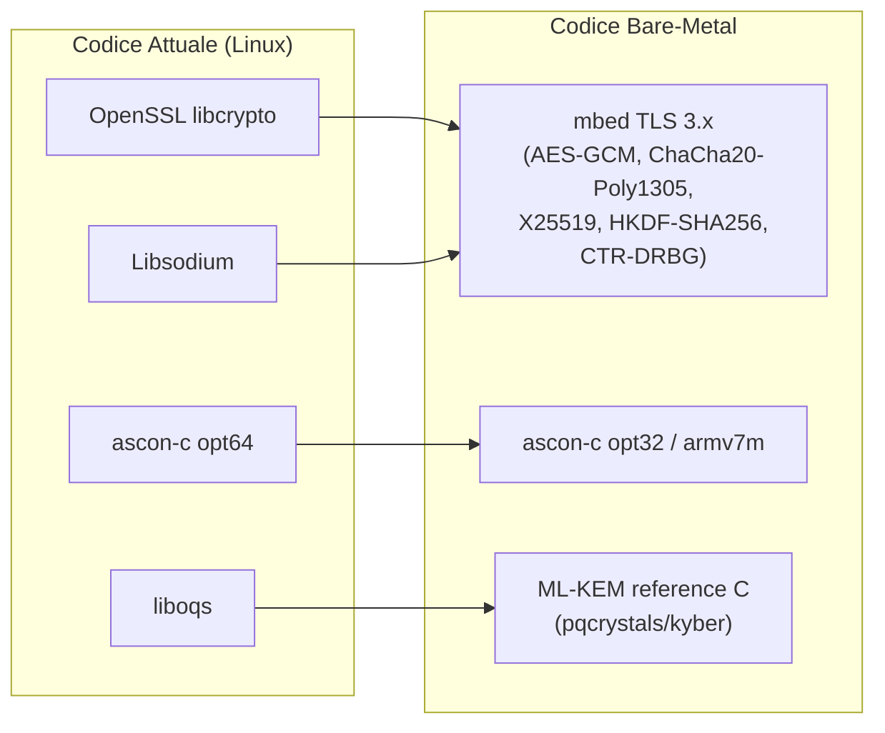
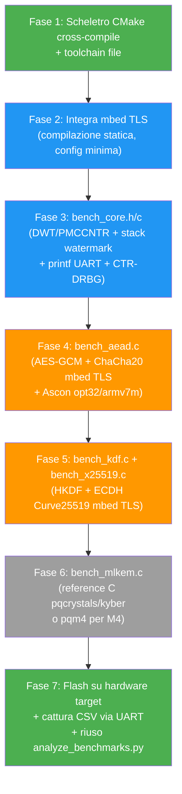

# 🗺️ Roadmap: Da Linux/x86 a Bare-Metal ARM (Cortex-M / Cortex-A)

## Stato Attuale — Cosa c'è nel codice oggi

Il benchmark attuale è un progetto **C++14 su Linux** con queste dipendenze:

| Componente | Dipendenza | Incompatibilità Bare-Metal |
|---|---|---|
| **AEAD Ascon-128** | `ascon-c` (standalone C) | ✅ Portabile (va solo cambiata variante) |
| **AES-256-GCM** | OpenSSL `EVP_*` | ❌ Richiede OS (libcrypto.so) |
| **ChaCha20-Poly1305** | OpenSSL `EVP_*` + Libsodium | ❌ Richiede OS |
| **X25519 (ECDH)** | Libsodium `crypto_kx_*` | ❌ Richiede OS |
| **PSK + KDF** | Libsodium `crypto_kdf_*` + HKDF-SHA256 | ❌ Richiede OS |
| **ML-KEM (PQC)** | liboqs | ❌ Richiede OS + malloc |
| **Cicli CPU** | `perf_event_open` (Linux) / `__rdtscp` (x86) | ❌ Syscall Linux |
| **RAM** | `getrusage()` (RSS virtuale) | ❌ Syscall Linux |
| **RNG** | `/dev/urandom` + `randombytes_buf()` | ❌ Filesystem Linux |
| **I/O** | `std::cout`, `std::ofstream` | ❌ Richiede stdio/filesystem |
| **Isolamento** | `fork()` + `waitpid()` | ❌ Syscall Linux |
| **Contenitori** | `std::vector`, `std::string` | ⚠️ Heap dinamico (malloc) |

---

## Fase 0 — Definizione dell'Architettura Target

Prima di toccare il codice, fissa due costanti:

```
TARGET_CORTEX = "M4" | "M7" | "A9" | "A53" | "A72" | ...
TARGET_CLOCK_HZ = 168000000  /* esempio STM32F4 @ 168 MHz */
```

> [!IMPORTANT]
> L'intera roadmap è scritta per essere **generica ARM Cortex-M / Cortex-A bare-metal**.
> Quando avrai l'hardware specifico, i soli punti da specializzare sono:
> - Il file di linker script (`.ld`) e startup (`startup_*.s`)
> - La configurazione clock (SystemClock_Config)
> - L'init UART per l'output seriale
> - La sorgente di entropia hardware (TRNG / rumore ADC)

---

## Fase 1 — Nuovo Scheletro Build: C Puro + CMake Cross-Compile

### 1.1 Struttura directory proposta

```
sonobuoy_bench_baremetal/
├── CMakeLists.txt               ← Cross-compile toolchain
├── toolchain-arm-none-eabi.cmake
├── src/
│   ├── main.c                   ← Entry point unico
│   ├── bench_core.h             ← Sostituto di benchmark_core.hpp
│   ├── bench_core.c
│   ├── bench_aead.c             ← Ascon + AES-GCM + ChaCha (mbed TLS)
│   ├── bench_kdf.c              ← PSK + HKDF (mbed TLS)
│   ├── bench_x25519.c           ← X25519 (mbed TLS)
│   ├── bench_mlkem.c            ← ML-KEM reference C (opzionale)
│   ├── hal/
│   │   ├── hal.h                ← Interfaccia HAL astratta
│   │   ├── hal_stm32f4.c        ← Implementazione per Cortex-M4
│   │   ├── hal_stm32h7.c        ← Implementazione per Cortex-M7
│   │   └── hal_cortexa.c        ← Implementazione per Cortex-A bare-metal
│   ├── uart_retarget.c          ← printf() → UART
│   └── rng_seed.c               ← Entropia HW → CTR-DRBG
├── lib/
│   ├── mbedtls/                 ← mbed TLS (compilata staticamente)
│   ├── ascon-c/                 ← ascon-c (variante opt32 o armv7m)
│   └── mlkem-c-ref/             ← ML-KEM reference C (opzionale)
├── linker/
│   ├── stm32f407.ld
│   ├── stm32h743.ld
│   └── cortexa_ram.ld
└── data/                        ← CSV ricevuti via UART
```

### 1.2 Toolchain file CMake

```cmake
# toolchain-arm-none-eabi.cmake
set(CMAKE_SYSTEM_NAME Generic)
set(CMAKE_SYSTEM_PROCESSOR arm)
set(CMAKE_C_COMPILER   arm-none-eabi-gcc)
set(CMAKE_CXX_COMPILER arm-none-eabi-g++)   # solo se serve C++
set(CMAKE_ASM_COMPILER arm-none-eabi-gcc)

set(CMAKE_C_FLAGS_INIT   "-mcpu=cortex-m4 -mthumb -mfloat-abi=hard -mfpu=fpv4-sp-d16 -ffunction-sections -fdata-sections -Os")
set(CMAKE_EXE_LINKER_FLAGS_INIT "-Wl,--gc-sections -specs=nosys.specs -specs=nano.specs")

set(CMAKE_FIND_ROOT_PATH_MODE_PROGRAM NEVER)
set(CMAKE_FIND_ROOT_PATH_MODE_LIBRARY ONLY)
set(CMAKE_FIND_ROOT_PATH_MODE_INCLUDE ONLY)
```

> [!NOTE]
> Per **Cortex-A bare-metal** cambia `-mcpu=cortex-m4 -mthumb` in `-mcpu=cortex-a9` (o `-mcpu=cortex-a53` per ARMv8-A 32-bit) e rimuovi `-mthumb`. Per A9 in 32-bit: `-mcpu=cortex-a9 -mfloat-abi=hard -mfpu=neon-vfpv3`.

---

## Fase 2 — Sostituzione delle Librerie Crittografiche

### Mappa di migrazione librerie



### 2.1 mbed TLS — La libreria universale per bare-metal

**mbed TLS** (ex PolarSSL) è progettata esplicitamente per microcontrollori. Vantaggi:

- **Zero dipendenze OS**: niente socket, niente filesystem, niente malloc (configurabile)
- **Compilazione statica**: un singolo `libmbedcrypto.a` da ~50–100 KB
- **Configurazione modulare**: `mbedtls_config.h` dove attivi solo i moduli che servono
- **Supporto completo** per tutti gli algoritmi che ti servono

**Moduli da abilitare in `mbedtls_config.h`:**

```c
// ---- Cifrari AEAD ----
#define MBEDTLS_AES_C
#define MBEDTLS_GCM_C
#define MBEDTLS_CHACHA20_C
#define MBEDTLS_POLY1305_C
#define MBEDTLS_CHACHAPOLY_C

// ---- Key Management ----
#define MBEDTLS_ECDH_C
#define MBEDTLS_ECP_C
#define MBEDTLS_ECP_DP_CURVE25519_ENABLED
#define MBEDTLS_HKDF_C
#define MBEDTLS_SHA256_C
#define MBEDTLS_MD_C

// ---- RNG ----
#define MBEDTLS_CTR_DRBG_C
#define MBEDTLS_ENTROPY_C
#define MBEDTLS_ENTROPY_HARDWARE_ALT   // fonte HW custom

// ---- Bare-metal ----
#define MBEDTLS_PLATFORM_C
#define MBEDTLS_PLATFORM_MEMORY         // hook per allocatore custom
#define MBEDTLS_NO_PLATFORM_ENTROPY     // no /dev/urandom
// Opzionale: #define MBEDTLS_MEMORY_BUFFER_ALLOC_C  per arena statica
```

> [!TIP]
> Per ridurre al minimo la RAM, abilita `MBEDTLS_MEMORY_BUFFER_ALLOC_C` e fornisci un buffer statico. mbed TLS userà quello invece di `malloc()`. In alternativa, su Cortex-M con poca RAM, puoi wrappare un semplice bump allocator.

### 2.2 Ascon-c — Cambio variante

Il tuo progetto già include `ascon-c`. Oggi usi **`opt64`** (ottimizzata per registri a 64 bit). Su ARM 32-bit devi switchare:

| Target | Variante ascon-c | Perché |
|---|---|---|
| Cortex-M4/M7 (ARMv7-M, Thumb-2) | **`bi32_armv7m`** | Bit-interleaving 32-bit + assembly ARM ottimizzato |
| Cortex-M0/M0+ (ARMv6-M) | **`bi32_armv6m`** | Subset ridotto di istruzioni |
| Cortex-A9 (ARMv7-A, 32-bit) | **`opt32`** oppure **`bi32_armv7m`** | 32-bit nativo, no registri 64-bit efficienti |
| Cortex-A53+ (ARMv8-A, 64-bit) | **`opt64`** (come oggi) | Registri nativi a 64-bit |

**Nel CMakeLists.txt cambia solo il path:**
```cmake
# Da:
set(ASCON_DIR "${CMAKE_CURRENT_SOURCE_DIR}/lib/ascon-c/crypto_aead/asconaead128/opt64")
# A (per Cortex-M):
set(ASCON_DIR "${CMAKE_CURRENT_SOURCE_DIR}/lib/ascon-c/crypto_aead/asconaead128/bi32_armv7m")
```

### 2.3 ML-KEM — Implementazione reference C standalone

Per ML-KEM (Kyber) su bare-metal, **liboqs non funziona** (dipende da OpenSSL + malloc pesante). Le alternative:

| Opzione | Repo | Pro | Contro |
|---|---|---|---|
| **pqcrystals/kyber** (reference C) | [github.com/pqcrystals/kyber](https://github.com/pqcrystals/kyber) | C puro, zero dipendenze | Nessuna ottimizzazione ARM |
| **pqm4** | [github.com/mupq/pqm4](https://github.com/mupq/pqm4) | Ottimizzato per Cortex-M4, assembly ARM | Solo M4 |
| **pqax** | [github.com/mupq/pqax](https://github.com/mupq/pqax) | Ottimizzato per Cortex-A | Solo Cortex-A |
| **liboqs-lite** (custom strip) | Build custom di liboqs | Compatibilità API | Lavoro di porting significativo |

> [!IMPORTANT]
> **Raccomandazione**: Usa **pqm4** per Cortex-M (è il benchmark di riferimento accademico per PQC su microcontrollori) e **pqcrystals/kyber reference C** come fallback per Cortex-A. Il reference C richiede solo di fornire un `randombytes()` custom che chiami il tuo CTR-DRBG.

---

## Fase 3 — Sostituzione del Layer di Misurazione (`benchmark_core.hpp` → `bench_core.h/.c`)

Questa è la riscrittura più critica. Ecco la mappatura punto per punto:

### 3.1 Lettura Cicli CPU

```c
// bench_core.h — versione bare-metal

#include <stdint.h>

static inline uint32_t read_cpu_cycles(void) {
#if defined(__ARM_ARCH_7M__) || defined(__ARM_ARCH_7EM__)
    // Cortex-M4 / M7: DWT Cycle Counter (Data Watchpoint & Trace)
    return *((volatile uint32_t *)0xE0001004);  // DWT->CYCCNT

#elif defined(__ARM_ARCH_7A__)
    // Cortex-A9 / A7: CP15 Performance Monitor (PMCCNTR)
    uint32_t val;
    __asm volatile("mrc p15, 0, %0, c9, c13, 0" : "=r"(val));
    return val;

#elif defined(__aarch64__)
    // Cortex-A53/A72 in bare-metal AArch64
    uint64_t val;
    __asm volatile("mrs %0, pmccntr_el0" : "=r"(val));
    return (uint32_t)val;

#else
    #error "Architettura non supportata"
#endif
}
```

**Inizializzazione necessaria (una tantum all'avvio):**

```c
void cycles_init(void) {
#if defined(__ARM_ARCH_7M__) || defined(__ARM_ARCH_7EM__)
    // Abilita DWT
    *((volatile uint32_t *)0xE000EDFC) |= (1 << 24);  // CoreDebug->DEMCR |= TRCENA
    *((volatile uint32_t *)0xE0001000) = 0;             // DWT->CTRL = 0 (reset)
    *((volatile uint32_t *)0xE0001004) = 0;             // DWT->CYCCNT = 0
    *((volatile uint32_t *)0xE0001000) = 1;             // DWT->CTRL |= CYCCNTENA

#elif defined(__ARM_ARCH_7A__)
    // Abilita PMU su Cortex-A9
    uint32_t val;
    // Enable all counters
    __asm volatile("mrc p15, 0, %0, c9, c12, 0" : "=r"(val));
    val |= (1 << 0) | (1 << 2);  // Enable + Reset cycle counter
    __asm volatile("mcr p15, 0, %0, c9, c12, 0" :: "r"(val));
    // Enable cycle counter specifically
    __asm volatile("mcr p15, 0, %0, c9, c12, 1" :: "r"(1 << 31));
#endif
}
```

> [!WARNING]
> Su Cortex-M, `DWT->CYCCNT` è un contatore a **32 bit** che wraparound a ~25 secondi @ 168 MHz. Per singole operazioni critto è più che sufficiente, ma per benchmark lunghi va gestito il wrap.

### 3.2 Misura RAM — Stack Watermarking

```c
// Sostituisce getrusage() (che non esiste su bare-metal)

#define STACK_FILL_PATTERN 0xDEADBEEF

extern uint32_t _estack;   // Definiti dal linker script
extern uint32_t _Min_Stack_Size;

void stack_paint(void) {
    volatile uint32_t *p = (volatile uint32_t *)((uint32_t)&_estack - (uint32_t)&_Min_Stack_Size);
    volatile uint32_t *end = (volatile uint32_t *)&_estack;
    // Attenzione: non sovrascrivere lo stack corrente! Parti dal fondo.
    register uint32_t sp_now;
    __asm volatile("mov %0, sp" : "=r"(sp_now));
    while ((uint32_t)p < sp_now - 64) {  // margine di sicurezza
        *p++ = STACK_FILL_PATTERN;
    }
}

uint32_t stack_used_bytes(void) {
    volatile uint32_t *p = (volatile uint32_t *)((uint32_t)&_estack - (uint32_t)&_Min_Stack_Size);
    while (*p == STACK_FILL_PATTERN) p++;
    return (uint32_t)&_estack - (uint32_t)p;
}
```

### 3.3 Misura Latenza (Tempo)

```c
// Il tempo si calcola direttamente dai cicli:
// latency_us = (double)cycles / (CLOCK_HZ / 1_000_000)

#ifndef CLOCK_HZ
#define CLOCK_HZ 168000000UL  // Da configurare per il target
#endif

static inline double cycles_to_us(uint32_t cycles) {
    return (double)cycles / ((double)CLOCK_HZ / 1000000.0);
}
```

### 3.4 RNG — Da `/dev/urandom` a CTR-DRBG hardware-seeded

```c
#include "mbedtls/ctr_drbg.h"
#include "mbedtls/entropy.h"

static mbedtls_ctr_drbg_context ctr_drbg;
static mbedtls_entropy_context entropy;

// Callback entropia hardware (da implementare per il target)
int hardware_entropy_source(void *data, unsigned char *output, size_t len, size_t *olen) {
    (void)data;
    // Esempio per STM32 con HAL:
    // for (size_t i = 0; i < len; i += 4) {
    //     uint32_t rnd;
    //     HAL_RNG_GenerateRandomNumber(&hrng, &rnd);
    //     memcpy(output + i, &rnd, (len - i >= 4) ? 4 : len - i);
    // }
    // Alternativa senza TRNG: rumore ADC (più lento, meno qualità)
    *olen = len;
    return 0;
}

void rng_init(void) {
    mbedtls_ctr_drbg_init(&ctr_drbg);
    mbedtls_entropy_init(&entropy);
    mbedtls_entropy_add_source(&entropy, hardware_entropy_source, NULL,
                                32, MBEDTLS_ENTROPY_SOURCE_STRONG);
    mbedtls_ctr_drbg_seed(&ctr_drbg, mbedtls_entropy_func, &entropy,
                          (const unsigned char *)"ATLAS_SONOBUOY", 14);
}

int rng_fill(unsigned char *buf, size_t len) {
    return mbedtls_ctr_drbg_random(&ctr_drbg, buf, len);
}
```

### 3.5 I/O — Da `std::cout`/`std::ofstream` a UART + printf retarget

```c
// uart_retarget.c — Redirect di printf() su UART hardware

#include <stdio.h>

// Per arm-none-eabi-gcc con newlib-nano (--specs=nano.specs):
int _write(int file, char *ptr, int len) {
    (void)file;
    for (int i = 0; i < len; i++) {
        // Esempio STM32 HAL:
        // HAL_UART_Transmit(&huart2, (uint8_t*)&ptr[i], 1, HAL_MAX_DELAY);

        // Esempio generico CMSIS:
        // while (!(USART2->SR & USART_SR_TXE));
        // USART2->DR = ptr[i];
    }
    return len;
}
```

> [!TIP]
> I CSV non vengono più scritti su file: li catturi direttamente da **PuTTY/Tera Term** con la funzione "Log to file", oppure li invii in formato CSV via `printf()` e li parsifichi con lo stesso script Python `analyze_benchmarks.py`.

### 3.6 Eliminazione di `fork()` e Isolamento Processi

Su bare-metal non esiste `fork()`. L'isolamento per la misura RAM diventa **inutile** perché:
- Non c'è OS → niente allocazioni spurie da parte del kernel
- Usi buffer statici → la RAM occupata è deterministica

**Soluzione**: esegui i benchmark sequenzialmente nel `main()`, con un reset del contatore DWT e uno stack watermark check tra un test e l'altro.

---

## Fase 4 — Riscrittura dei Benchmark (da C++ a C puro)

### 4.1 Eliminazione interfaccia virtuale C++

L'attuale `ICryptoAlgorithm` con vtable va sostituita con **function pointers** o semplicemente **chiamate dirette**:

```c
// bench_aead.c — Esempio struttura per Cortex-M/A bare-metal

#include "bench_core.h"
#include "mbedtls/gcm.h"
#include "mbedtls/chachapoly.h"
// + include ascon-c

// Buffer statici globali (no malloc)
static uint8_t key_aes[32];
static uint8_t key_chacha[32];
static uint8_t key_ascon[16];
static uint8_t nonce[16];
static uint8_t plaintext[1024];   // Max payload
static uint8_t ciphertext[1024 + 16 + 16];  // payload + tag + nonce
static uint8_t tag[16];

typedef struct {
    const char *name;
    size_t overhead;  // nonce + tag bytes
    void (*init)(void);
    void (*encrypt)(const uint8_t *pt, size_t pt_len,
                    uint8_t *ct, size_t *ct_len);
} aead_algo_t;

// ----- AES-256-GCM via mbed TLS -----
static mbedtls_gcm_context gcm_ctx;

static void aes_gcm_init(void) {
    rng_fill(key_aes, 32);
    mbedtls_gcm_init(&gcm_ctx);
    mbedtls_gcm_setkey(&gcm_ctx, MBEDTLS_CIPHER_ID_AES, key_aes, 256);
}

static void aes_gcm_encrypt(const uint8_t *pt, size_t pt_len,
                             uint8_t *ct, size_t *ct_len) {
    static uint64_t counter = 0;
    counter++;
    memcpy(nonce, &counter, sizeof(counter));
    mbedtls_gcm_crypt_and_tag(&gcm_ctx, MBEDTLS_GCM_ENCRYPT,
                               pt_len, nonce, 12,
                               NULL, 0,         // no AAD
                               pt, ct,
                               16, tag);         // 16-byte tag
    *ct_len = pt_len + 16;  // ciphertext + tag
}

// ----- ChaCha20-Poly1305 via mbed TLS -----
static mbedtls_chachapoly_context cp_ctx;

static void chacha_init(void) {
    rng_fill(key_chacha, 32);
    mbedtls_chachapoly_init(&cp_ctx);
    mbedtls_chachapoly_setkey(&cp_ctx, key_chacha);
}

static void chacha_encrypt(const uint8_t *pt, size_t pt_len,
                            uint8_t *ct, size_t *ct_len) {
    static uint64_t counter = 0;
    counter++;
    memcpy(nonce, &counter, sizeof(counter));  // 12 byte nonce
    mbedtls_chachapoly_encrypt_and_tag(&cp_ctx,
                                        pt_len, nonce,
                                        NULL, 0,   // no AAD
                                        pt, ct, tag);
    *ct_len = pt_len + 16;
}

// ----- Ascon-AEAD128 (ascon-c) -----
// [come oggi, ma senza std::vector]

// ----- Array algoritmi -----
static const aead_algo_t algorithms[] = {
    {"AES-256-GCM (mbed TLS)",       28, aes_gcm_init,  aes_gcm_encrypt},
    {"ChaCha20-Poly1305 (mbed TLS)", 28, chacha_init,   chacha_encrypt},
    {"Ascon-AEAD128 (ascon-c)",      32, ascon_init,    ascon_encrypt},
};
```

### 4.2 Loop di benchmark (sostituisce `run_benchmark_suite`)

```c
#define WARMUP_ITERS    100
#define MEASURE_ITERS   5000

static const size_t packet_sizes[] = {8, 16, 32, 64, 128, 255, 1024};
#define N_SIZES (sizeof(packet_sizes)/sizeof(packet_sizes[0]))

void run_aead_benchmarks(void) {
    for (size_t a = 0; a < sizeof(algorithms)/sizeof(algorithms[0]); a++) {
        algorithms[a].init();
        printf("\n=== %s ===\n", algorithms[a].name);
        printf("payload_bytes,cycles_per_op,cycles_per_byte,latency_us,stack_bytes\n");

        for (size_t s = 0; s < N_SIZES; s++) {
            size_t plen = packet_sizes[s];
            memset(plaintext, 0x42, plen);
            size_t ct_len;

            // Warm-up
            for (int i = 0; i < WARMUP_ITERS; i++) {
                algorithms[a].encrypt(plaintext, plen, ciphertext, &ct_len);
                do_not_optimize_away(ciphertext[0]);
            }

            // Misura con stack watermark
            stack_paint();

            uint32_t c0 = read_cpu_cycles();
            for (int i = 0; i < MEASURE_ITERS; i++) {
                algorithms[a].encrypt(plaintext, plen, ciphertext, &ct_len);
                do_not_optimize_away(ciphertext[0]);
            }
            uint32_t c1 = read_cpu_cycles();

            uint32_t total_cycles = c1 - c0;
            uint32_t cycles_per_op = total_cycles / MEASURE_ITERS;
            double cpb = (double)cycles_per_op / plen;
            double latency = cycles_to_us(cycles_per_op);
            uint32_t stack = stack_used_bytes();

            // Output CSV via UART
            printf("%u,%u,%.2f,%.4f,%u\n",
                   (unsigned)plen, (unsigned)cycles_per_op,
                   cpb, latency, (unsigned)stack);
        }
    }
}
```

---

## Fase 5 — Key Management (PSK + KDF + X25519) via mbed TLS

### 5.1 PSK + HKDF (sostituisce Libsodium `crypto_kdf`)

```c
#include "mbedtls/hkdf.h"
#include "mbedtls/md.h"

void bench_psk_hkdf(void) {
    uint8_t psk[32], session_key[32];
    rng_fill(psk, 32);

    uint8_t salt[8] = "ATLAS_KM";

    for (int i = 0; i < MEASURE_ITERS; i++) {
        uint8_t info[12];
        memcpy(info, "SEQ_", 4);
        uint32_t seq = (uint32_t)i;
        memcpy(info + 4, &seq, 4);

        mbedtls_hkdf(mbedtls_md_info_from_type(MBEDTLS_MD_SHA256),
                     salt, sizeof(salt),
                     psk, sizeof(psk),
                     info, 8,
                     session_key, sizeof(session_key));
        do_not_optimize_away(session_key[0]);
    }
}
```

### 5.2 X25519 (sostituisce Libsodium `crypto_kx`)

```c
#include "mbedtls/ecdh.h"
#include "mbedtls/ecp.h"

void bench_x25519(void) {
    mbedtls_ecdh_context ctx_client, ctx_server;
    mbedtls_ecdh_init(&ctx_client);
    mbedtls_ecdh_init(&ctx_server);

    mbedtls_ecdh_setup(&ctx_client, MBEDTLS_ECP_DP_CURVE25519);
    mbedtls_ecdh_setup(&ctx_server, MBEDTLS_ECP_DP_CURVE25519);

    // ... keygen + compute shared secret usando mbedtls_ecdh_gen_public
    // e mbedtls_ecdh_compute_shared con il tuo rng_fill come f_rng

    mbedtls_ecdh_free(&ctx_client);
    mbedtls_ecdh_free(&ctx_server);
}
```

---

## Fase 6 — ML-KEM Reference C (opzionale, a priorità bassa)

Data la conclusione nel documento ATLAS (PSK è la soluzione primaria per le boe GWB), ML-KEM su bare-metal è un nice-to-have per completezza accademica.

**Passi:**
1. Clona `pqcrystals/kyber` (reference C)
2. Implementa `randombytes()` come wrapper di `rng_fill()` (il tuo CTR-DRBG)
3. Compila `kem.c`, `indcpa.c`, `poly.c`, `polyvec.c`, `ntt.c`, `cbd.c`, `reduce.c`, `verify.c`
4. Per **Cortex-M4**, valuta di usare **pqm4** che ha NTT assembly ottimizzato

---

## Fase 7 — Checklist Differenze Cortex-M vs Cortex-A

| Aspetto | Cortex-M (M4 / M7) | Cortex-A (A9 / A53) |
|---|---|---|
| Contatore cicli | `DWT->CYCCNT` (32 bit) | CP15 `PMCCNTR` o `PMCCNTR_EL0` |
| Abilitazione | `CoreDebug->DEMCR` | MCR p15 / MSR |
| Stack | Tipicamente 8–64 KB | Molto più grande (MB) |
| Allocazione | Rigorosamente statica | Possibile heap se necessario |
| Output UART | STM32 HAL / CMSIS | PL011 o simile (memory-mapped) |
| TRNG | Periferico RNG integrato (se presente) | Spesso assente → rumore ADC |
| Compilazione | `-mcpu=cortex-m4 -mthumb` | `-mcpu=cortex-a9` (no thumb obbligatorio) |
| Cache | Nessuna (M4) / iCache+dCache (M7) | L1+L2 → impatta benchmark! |
| FPU | Opzionale (SP su M4, DP su M7) | VFP/NEON |

> [!WARNING]
> Su **Cortex-A con cache**, i primi run di un benchmark toccano memoria fredda (compulsory miss). Per benchmark accurati serve un warm-up adeguato (come già fai, ma con attenzione alla cache invalidation tra test diversi).

---

## Riepilogo Priorità e Sequenza di Lavoro



> [!IMPORTANT]
> **Le Fasi 1–3 sono propedeutiche a tutto il resto** e possono essere sviluppate e testate in cross-compilazione sul tuo PC Windows (con `arm-none-eabi-gcc`) anche senza avere l'hardware fisico. Il codice compilerà e genererà il `.elf` / `.bin`, pronto per essere flashato quando arrivano le board.

---

## Script Python (`analyze_benchmarks.py`)

Lo script Python esistente non va toccato nella logica. L'unica modifica è:
- I CSV in input avranno **campi leggermente diversi** (niente `energy_uj` RAPL, niente `ram_kb` da RSS, ma `stack_bytes` da watermarking)
- Il campo `energy_uj` diventa opzionale o viene misurato esternamente (multimetro/INA219)

Basterà aggiungere un paio di righe al parser per gestire il formato bare-metal.
